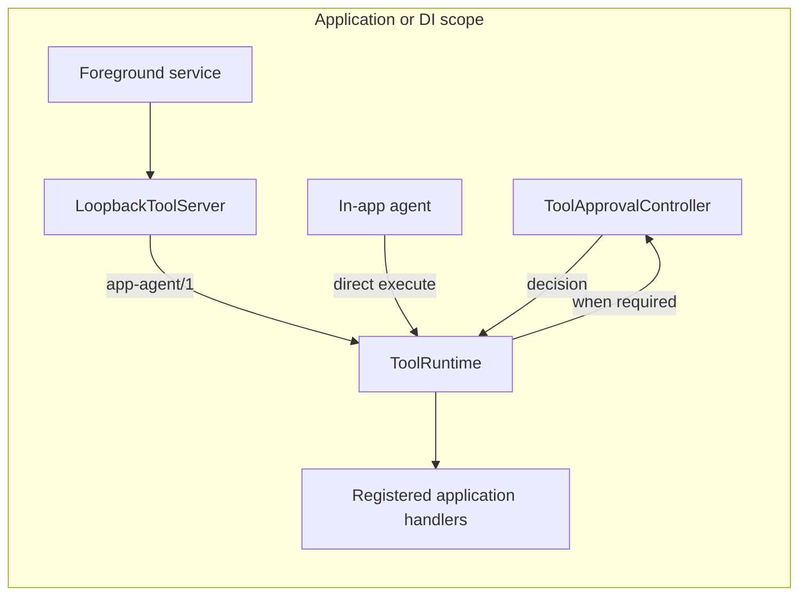

# Android integration

## Recommended ownership

The application dependency-injection container should own a singleton `ToolRuntime`. The foreground service and in-app agent then share the same instance.



A handler captures an application repository in its closure:

```kotlin
class AppToolModule(
    private val accountRepository: AccountRepository,
) {
    val approvals = ToolApprovalController()

    val runtime = ToolRuntime(
        approvalDecisionHandler = approvals,
    ).apply {
        register(accountBalanceSpec) { input, _ ->
            accountRepository.getBalanceJson(input)
        }
    }
}
```

The signed-in session and access token remain inside the application process.

## Foreground service

The SDK does not declare an Android `Service` because notification behavior, lifecycle policy, and dependency injection differ by application. Start and stop the server from an application-owned service:

```kotlin
class AppToolService : Service() {
    private lateinit var server: LoopbackToolServer

    override fun onCreate() {
        super.onCreate()
        startForeground(NOTIFICATION_ID, createNotification())
        server = LoopbackToolServer(
            runtime = appGraph.toolRuntime,
            port = 8765,
            bearerToken = appGraph.pairingSession.currentToken,
        )
        server.start()
    }

    override fun onStartCommand(intent: Intent?, flags: Int, startId: Int): Int = START_STICKY

    override fun onDestroy() {
        server.close()
        super.onDestroy()
    }

    override fun onBind(intent: Intent?): IBinder? = null
}
```

The example manifest demonstrates foreground-service and notification permissions. A production application must review service lifetime against its target SDK, foreground-service type, user-visible behavior, and store policy. The SDK does not assume permanent background execution.

## ADB connection

The server listens only on device `127.0.0.1:8765`:

```bash
adb forward tcp:18765 tcp:8765
curl http://127.0.0.1:18765/healthz
curl -H "Authorization: Bearer $TOKEN" http://127.0.0.1:18765/v1/tools
```

The model provider process never connects to Android directly. The desktop harness reads the manifest and forwards validated ToolCalls.

## In-app calls

An in-app agent bypasses HTTP:

```kotlin
val result = toolRuntime.execute(
    call = ToolCall(callId, selectedTool, modelInput),
    attributes = mapOf(
        "source" to "In-app agent",
        "transport" to "direct",
    ),
)
```

Desktop and in-app callers therefore share input validation, approval, handler behavior, and error semantics.

The optional debug Inspector uses the `source` and `transport` attributes
as display metadata. Other attributes remain visible in call details.

## Optional UI fallback for a desktop harness

The Kotlin runtime intentionally does not expose screen automation. A desktop harness can separately install the repository's generic UiAutomator2 instrumentation companion and append `mobile_*` base tools when an existing UI flow has no semantic application tool. That companion is fixed to one target package at startup and returns compact flat JSON rather than raw XML. See [Android UI automation fallback](android-ui-automation.md).

## Mobile approval UI

`ToolApprovalController` is an application-scoped, suspending approval handler with a bounded FIFO queue:

```kotlin
val approvals = ToolApprovalController(
    ToolApprovalConfiguration(
        decisionTimeoutMillis = 60_000L,
        maxPendingRequests = 16,
    ),
)

val runtime = ToolRuntime(
    approvalDecisionHandler = approvals,
)
```

Install exactly one lifecycle-aware host at the Activity root:

```kotlin
setContent {
    AppTheme {
        AppNavigation()
        ToolApprovalHost(controller = approvals)
    }
}
```

Queued requests do not start their timeout. The current request receives the full configured window after the dialog reaches a rendered frame. The host correlates actions by call ID and advances one persistent dialog through the queue.

Use `ToolApprovalNotificationBridge` to direct a background user back to that host. The bridge posts only an aggregate request count and no tool content. The host application owns `POST_NOTIFICATIONS`, the notification icon, and the navigation `PendingIntent`.

An existing Java application can continue to use `ToolRuntime.withBlockingApproval(...)`; invoke that adapter from a runtime worker thread, never the Android main thread. New Compose integrations should prefer the detailed controller so timeout and unavailable outcomes remain distinct.

PINs, OTPs, passwords, and tokens never belong in ToolCall input. Collect secure
values only inside application-owned approval content or a subsequent secure
flow, and resolve only the final decision to the runtime. See
[On-device tool approval](on-device-approval.md) and
[Compose approval UI](compose-approval-ui.md).

## Remote transport

Do not change `LoopbackToolServer` to bind to `0.0.0.0`, and do not bundle ngrok in the APK. Implement remote connectivity as a separate relay transport with:

- explicit device pairing;
- short-lived session credentials;
- TLS;
- call ID or nonce replay protection;
- connection and approval auditing;
- immediate session invalidation when the user signs out.

Adding a relay transport does not change ToolSpec, registration, or handler APIs.

## Debug audit UI

Install `app-agent-inspector` only in debug variants and
`app-agent-inspector-noop` in release variants. Both expose the same
`AppAgentInspector.install(...)` API, so application initialization can stay
in `src/main`. The real artifact observes the shared `ToolRuntime` and can
open from a foreground shake; the release artifact performs no work.

See [Debug audit inspector](debug-inspector.md).
