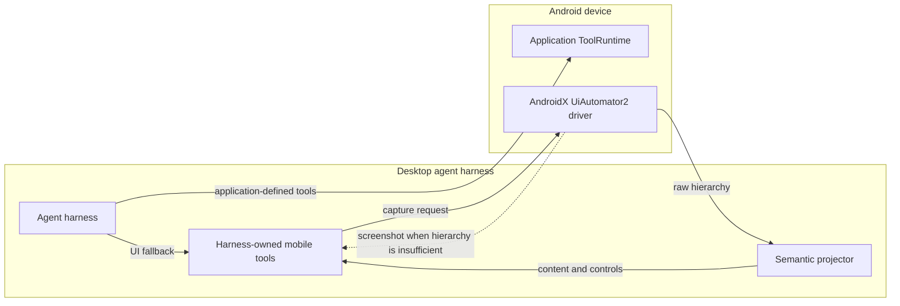

# Android UI automation fallback

The Kotlin SDK exposes application-defined semantic tools. Some app flows still require interaction with an existing screen that has no semantic tool. The optional Android UI driver and desktop harness tools cover that fallback without changing the `ToolSpec(name, description, inputSchema)` contract.

This is not MCP, and the UiAutomator tools are not predefined business-domain tools. They are harness-owned base tools which can coexist with tools registered by any Android application.

## Architecture



The instrumentation driver is started with one trusted target application ID. The application ID is not a model argument. Every input action verifies that the target application is still foregrounded.

## One observation, two semantic sections

`mobile_observe` performs one hierarchy capture and returns one snapshot with two distinct sections:

```json
{
  "snapshotId": "ui-...",
  "packageName": "com.example.app",
  "screen": { "width": 1080, "height": 2400, "rotation": 0 },
  "content": [
    {
      "role": "text",
      "text": "Review the transfer details",
      "bounds": [48, 180, 1032, 248]
    }
  ],
  "controls": [
    {
      "nodeId": "c1",
      "role": "button",
      "label": "Continue",
      "bounds": [48, 2080, 1032, 2224],
      "actions": ["tap"]
    }
  ]
}
```

- `content` contains non-actionable text or descriptions useful for understanding the screen.
- `controls` contains actionable elements, stable only within that snapshot, with their label, state, bounds, and supported actions.
- `scope: "content"` or `scope: "controls"` omits the other section when the model needs only one kind of context. `scope: "all"` is the default.

Separate read and control tools would dump the same screen twice, increase latency, and can return two different UI states. One snapshot preserves consistency while the two arrays preserve the semantic distinction. A clickable container absorbs its non-actionable child labels, so the same row is not repeated in both sections.

## Why canonical JSON, not XML or YAML

Raw UiAutomator XML is an internal driver response. It is never included in the model prompt or stored in an agent trace.

The projector emits JSON because ToolResults and the existing protocol already use JSON, provider adapters can serialize it without another parser, and the format is deterministic for snapshot fingerprinting. YAML would save little after removing layout-only nodes while adding scalar and escaping ambiguity.

The projector performs these generic transformations:

1. keep visible nodes belonging to the target package allowlist supplied at runtime;
2. remove layout-only containers with no readable or actionable semantics;
3. map Android widget, Compose accessibility, and WebView accessibility nodes to a small role vocabulary;
4. merge descendant labels into an actionable parent without exposing hierarchy depth;
5. sort the flat arrays in visual reading order;
6. mask password values, truncate oversized text, deduplicate nodes, and enforce node/text budgets;
7. fingerprint the complete semantic state, including nodes omitted from the output budget.

There are no filters for a sample app's package, resource IDs, text, screen structure, or domain. Custom-rendered canvases that do not expose accessibility semantics naturally produce little hierarchy content and trigger the screenshot fallback.

## Harness-owned tools

Each base tool uses the same three-field model-facing specification as an application tool.

| Tool | Purpose |
|---|---|
| `mobile_observe` | Return flat `content` and `controls` from UiAutomator2 |
| `mobile_screenshot` | Attach a PNG to the model after an unchanged semantic snapshot |
| `mobile_tap` | Tap one `nodeId` or one screenshot coordinate |
| `mobile_long_press` | Long-press one eligible control or coordinate |
| `mobile_multi_tap` | Tap multiple different positions once each, in exact array order |
| `mobile_input_text` | Replace text through a `text_field` node |
| `mobile_swipe` | Swipe between two positions |
| `mobile_press` | Press only `BACK` or `ENTER` |
| `mobile_wait` | Wait for readable text, a control label, or a resource ID |

Semantic application tools remain the preferred path. The agent uses these UI tools only when the app has not registered a suitable semantic capability.

## Screenshot fallback

The model must call `mobile_observe` first. `mobile_screenshot` accepts that snapshot ID and rejects the call if the semantic state changed. Screenshot bytes are attached as an actual provider image part; they are replaced with metadata in JSON prompts, conversation history, web events, and persisted traces.

Typical fallback cases include a custom canvas, a randomized keypad whose keys have no accessibility nodes, ambiguous icons, or a visual chart. `mobile_multi_tap` is specifically an ordered list of different coordinates, not a double-tap count.

## Snapshot safety

Every action references a `snapshotId`. Before injecting input, the desktop client captures the hierarchy again and compares the complete semantic fingerprint. A changed screen fails with `STALE_UI_SNAPSHOT` and requires a new observation. A `nodeId` is intentionally short and local to one snapshot; it is not a long-lived selector.

Password node values are masked in observations. Text values and ordered multi-tap coordinates are redacted from model follow-up prompts, conversation history, and persisted traces after execution. For PINs, transaction passwords, biometric prompts, or other secrets, still prefer an app-owned approval or human-input UI that keeps the secret out of the model context. Coordinate automation should not be treated as a replacement for that boundary.

## Development setup

The current driver is an Android instrumentation companion for an ADB-connected device or emulator. It is not linked into the target APK and is not a production remote-control service.

The desktop projector/client is packaged in the TypeScript workspace as `@pumpkinredbean/app-agent-android-ui`. It depends on `@pumpkinredbean/app-agent-client` for the shared protocol contract and ToolCall errors. Automated npm publication is not configured yet.

From the weather example desktop directory:

```bash
npm run ui:driver:build
npm run ui:driver:install
npm run ui:driver -- start --target=io.github.pumpkinredbean.appagent.example.weather
```

Keep the target application foregrounded and leave the last command running. In another terminal, start the agent UI:

```bash
npm run ui
```

Use `--serial=<adb-serial>` or `ANDROID_SERIAL` when multiple devices are attached. The default ADB forwards are:

| Desktop endpoint | Device endpoint |
|---|---|
| `127.0.0.1:18765` | Target application `ToolRuntime` on `127.0.0.1:8765` |
| `127.0.0.1:18766` | UiAutomator2 driver on `127.0.0.1:8766` |

Run `npm run ui:driver:status` to inspect the current target/foreground package and `npm run ui:driver:stop` to stop the companion.

## Current boundary

The driver is appropriate for local development, evaluation, and controlled demonstrations. A shipped product should use app-defined semantic tools and app-owned approval as its primary interface. If a production UI fallback is required, it needs a separately reviewed deployment, pairing, authentication, audit, accessibility, and user-consent design.
