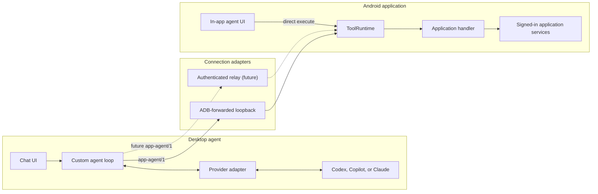
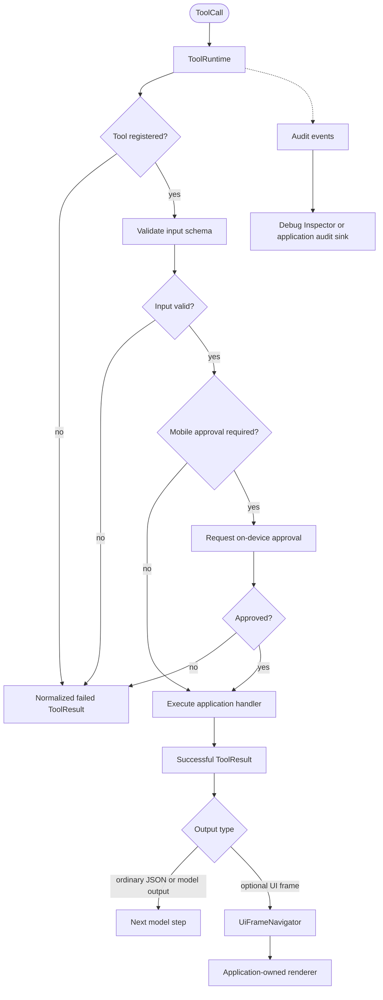

# App Agent Interface SDK architecture

## Goal

One set of application capabilities should serve both of these callers:

1. a custom agent running behind a desktop chat UI;
2. an in-app agent UI.

The model does not control the complete Android UI or operating system. It can call only handlers that the application explicitly registers.

### Connection paths



### Runtime execution and result routing



## Layer responsibilities

### Model tool specification

```kotlin
ToolSpec(name, description, inputSchema)
```

This is the information a model needs to select a tool and generate its arguments. It contains neither implementation details nor security policy.

### Registration

`ToolRegistry` associates a ToolSpec with its handler and `ToolApproval` policy. It rejects duplicate names. Closing a registration removes it from the registry.

### Runtime

`ToolRuntime` conditionally evaluates these stages:

1. verify that the tool is registered;
2. validate the input against its JSON Schema;
3. request approval when the policy is `MOBILE`;
4. execute the application handler;
5. return either output or a normalized error.

Model-generated names and arguments are never passed directly to application APIs without validation.

The runtime emits audit events only for stages that actually occur. A read-only
tool therefore has no approval events, invalid input never has an execution
event, and cancellation does not fabricate a `ToolResult`. Listener failures
are isolated from execution.

`ToolApprovalController` is an application-scoped FIFO coordinator rather than a fixed execution pipeline. It is invoked only when runtime policy requires approval. One Compose host observes its state, presents one current request, and advances to later requests after a decision. Queue wait time does not consume the current request's presentation-only timeout.

### Transport

Transport carries `tools.list`, `tool.call`, and `tool.result` messages. It does not define tool semantics. The current loopback HTTP transport is designed for ADB forwarding and always binds to `127.0.0.1`.

Remote connectivity should be implemented as a separate authenticated WebSocket or relay adapter on top of the same application runtime.

### Optional application UI

`app-agent-ui` lets a handler pair concise model-readable output with an
application-defined `UiFrame(tag, params, payload)`. The value is encoded inside
the existing unrestricted `ToolResult.output`; it does not add fields to
`ToolSpec` or change `app-agent/1`.

The host returns only `modelOutput` to the model and routes the frame through
`UiFrameNavigator` and its own tag-to-renderer registry. `tag + params` is the
navigation identity, while changing live values belong in `payload`.

Starting a new user turn pauses the current frame. Navigating, going back,
explicitly resuming, and closing a session produce `RESUMED`, `PAUSED`, and
`DISPOSED` events that renderers use to manage live resources. The optional
Compose adapter owns no domain UI or second navigation stack. See
[Application-defined UI frames](ui-frames.md).

### Agent harness

The agent loop and chat UI live outside the Kotlin SDK. The current Node.js example selects a provider, maps the mobile manifest to that provider's tool format, validates the selected call, and sends only the normalized ToolCall to the mobile runtime.

The example can also add optional harness-owned Android UI tools. They run through a separate UiAutomator2 instrumentation companion, remain scoped to one target package chosen at startup, and do not become Kotlin SDK domain tools. The agent should prefer application-defined semantic tools and use the UI path only as a fallback. See [Android UI automation fallback](android-ui-automation.md).

### Debug Inspector

The optional Android Inspector subscribes to `ToolRuntime` audit events and
keeps a bounded in-memory history. Its real artifact contains a non-exported
Compose Activity and a foreground-only shake detector. An API-compatible no-op
artifact lets release variants compile the same application initialization code
without shipping Inspector behavior.

It is a developer tool, not a durable compliance log. Production persistence
belongs to an application-owned audit listener with explicit retention and
access-control policy.

## Provider mapping

Provider-specific names are introduced only inside the provider adapter.

| Canonical | OpenAI/Codex | Claude | Copilot | Vercel AI SDK |
|---|---|---|---|---|
| `name` | `name` | `name` | `name` | tools map key / `name` |
| `description` | `description` | `description` | `description` | `description` |
| `inputSchema` | `parameters` | `input_schema` | `parameters` | `inputSchema` |

Fields such as `type`, `strict`, `deferLoading`, and `providerOptions` are adapter concerns. They are not added to the canonical ToolSpec.

## Security boundary

- The model and desktop harness never receive mobile authentication tokens.
- A handler uses authenticated repositories or services inside the application process.
- ToolCall input is untrusted data generated by a user or model.
- Approval is enforced by application runtime policy, not by model instructions.
- PINs, OTPs, passwords, and access tokens remain outside ToolCall and are collected only by app-owned secure UI.
- The current ADB approval queue is in-memory and is never restored after Android process death.
- Loopback binding limits network exposure but does not replace authentication.
- Production sessions should use a session bearer or pairing credential.
- Model outputs and UI frame payloads should contain only the data required by
  their consumers, not raw internal DTOs or credentials.

## Non-goals

- implementing an MCP server;
- providing a predefined finance or commerce tool catalog;
- wrapping the Codex or Claude Code user interface;
- providing unrestricted device-wide Android automation as part of the Kotlin runtime;
- creating a common abstraction for every provider-specific advanced field.
