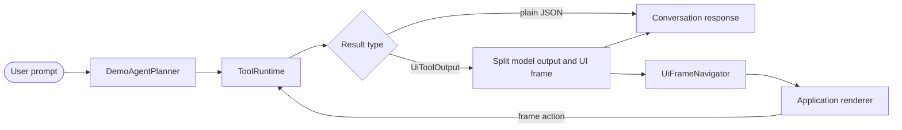

# Native trading agent example

This Android example shows how an in-app agent can execute application-defined
tools directly through `ToolRuntime` and render `UiFrame` results through the
optional Compose host. It is an example application, not a finance API or a
domain-tool catalog shipped by the SDK.

The market feed polls Binance public Spot ticker and depth endpoints while a
market frame is resumed and falls back to bundled fixtures when the network is
unavailable. The sample supports BTC, ETH, SOL, and BNB. Orders and portfolio
changes are process-local simulations and never reach an exchange.

The bundled `DemoAgentPlanner` is deliberately offline and deterministic. It
does not call an LLM and does not prove provider-side tool selection. It exists
so the Android interaction, navigation, lifecycle, and approval flow can be
evaluated without provider credentials. A real in-app agent should give
`runtime.manifest()` to its model gateway and execute selected calls through
the same `ToolRuntime`.

## Tool surface

| Tool | Output | Mobile approval |
|---|---|---|
| `get_market_symbols` | Supported symbol list | No |
| `get_market_quote` | Plain current-quote JSON | No |
| `get_portfolio_return` | Plain process-local return JSON | No |
| `visualize_market_overview` | Personalized overview frame | No |
| `visualize_market_asset` | Live market and depth frame | No |
| `visualize_portfolio` | Cash and positions frame | No |
| `visualize_portfolio_return` | Return-driver frame | No |
| `visualize_allocation` | Candidate allocation comparison frame | No |
| `prepare_order` | Non-executing order-review frame | No |
| `submit_order` | Local fill and completed-order frame | Yes |
| `visualize_order_activity` | Process-local order history frame | No |

`get_*` tools answer factual questions without opening a new interface.
`visualize_*` tools deliberately produce a frame. Order preparation also
produces a review frame because the user must inspect it before the separately
approved `submit_order` action.

## Interaction model



- The conversation remains one session; a context frame appears above it.
- Focusing the conversation hides the frame without removing its navigation
  state, and the active-context control returns to it.
- `tag + params` forms a deduplicated back stack. Frame actions navigate inside
  the frame surface instead of fabricating chat messages.
- Starting a new user turn pauses the current live frame. Its renderer stops
  polling while paused and resumes only after an explicit resume or navigation.
- Light and dark presentation are application-owned and are not SDK themes.

## Approval and keypad boundary

`submit_order` uses `ToolApproval.MOBILE` and the application-owned content
overload of `ToolApprovalHost`. The review and keypad remain inside one queued
approval request, so only the currently presented request consumes its
60-second timeout.

The keypad accepts any four positions in this demo. It is not a PIN validator,
passkey flow, Android biometric prompt, or device-credential check. Its entered
digits stay in Composable state, are cleared before approval, and never become
tool arguments, model context, frame payload, or tool results.

## SDK integration

The example uses the repository root as a Gradle composite build:

```groovy
includeBuild("../../..")
```

Its application dependencies are the runtime, framework-neutral UI contract,
and Compose adapter. The `0.5.0-SNAPSHOT` coordinates are substituted by the
composite build; an external consumer should use the latest release in the
[Kotlin SDK guide](../../docs/sdk/kotlin-sdk.md).

## Run

Requirements: JDK 17, Android SDK 35, and an emulator or USB-debuggable device.

```bash
cd examples/trading-agent/android
ANDROID_HOME="$HOME/Library/Android/sdk" ./gradlew :app:installDebug
adb shell am start -n io.github.pumpkinredbean.appagent.example.tradingv3/.MainActivity
```

Use the actual Android SDK location. A Homebrew command-line-tools installation
may use `/opt/homebrew/share/android-commandlinetools`.

Try prompts such as:

- `What is my return today?` — factual `get_*` result; no new UI frame
- `Show Bitcoin details` — live, turn-scoped market frame
- `Show my portfolio`
- `Compare adding 1,000 USDT`
- `Prepare an order to buy 500 USDT of BTC`

The order remains local. The secure keypad value stays inside the approval UI, and only the final approval boolean reaches the tool runtime.

## What this sample demonstrates

- ordinary `get_*` results stay in the conversation and do not open UI;
- `visualize_*` and review tools return app-defined frames;
- a new user turn pauses the previous live frame, while Resume explicitly reconnects it;
- `tag + params` provides a deduplicated mobile-style back stack;
- frame buttons navigate inside the service UI without forcing a chat transition;
- one approval consumer shows queued actions sequentially, and only the visible action starts its 60-second timer;
- secure-keypad values never become tool arguments or model context.

## Verify

```bash
# From the repository root
./gradlew test

cd examples/trading-agent/android
./gradlew :app:testDebugUnitTest :app:assembleDebug :app:assembleRelease
```

Unit tests cover factual-versus-visual planning, symbol selection, tool
registration, ordinary JSON results, and UI-frame outputs. Root SDK tests cover
frame encoding, navigation identity, lifecycle, and approval queue behavior.
