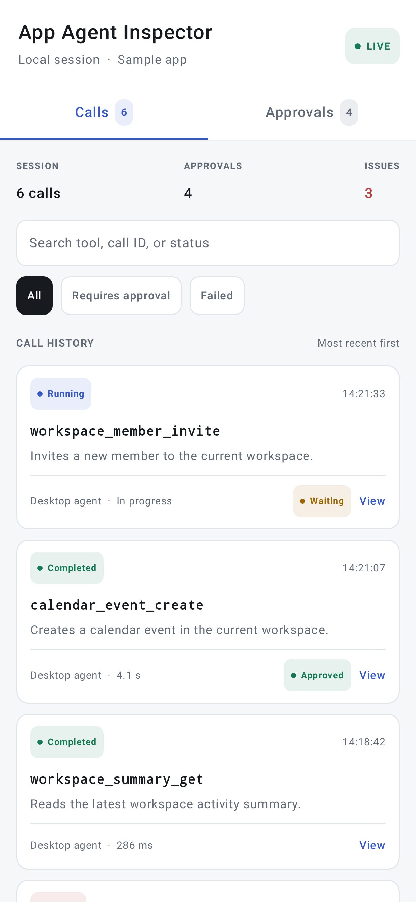
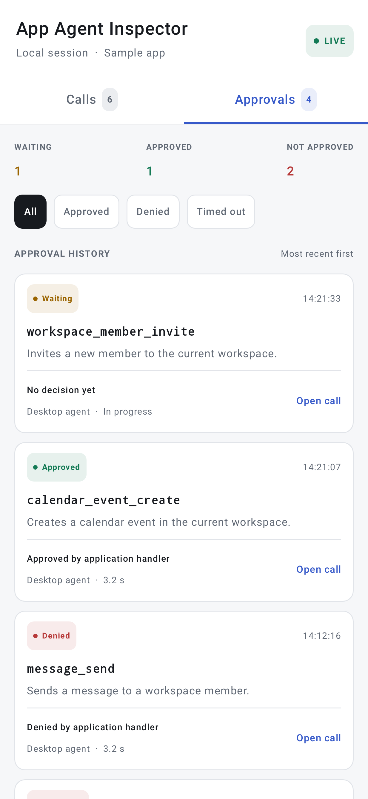
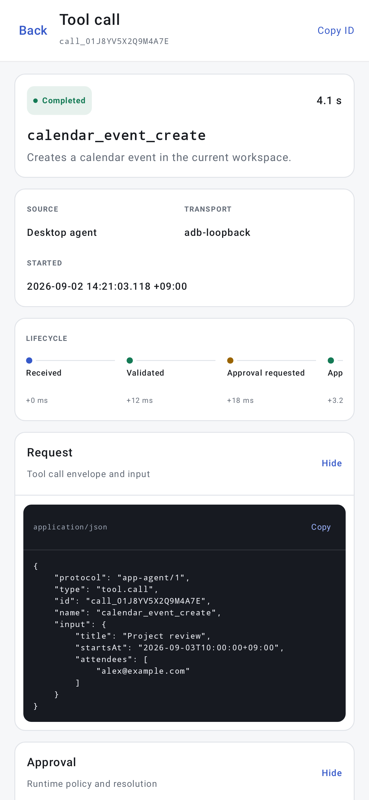
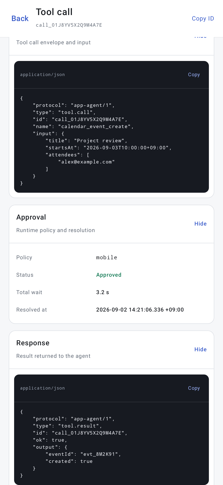

# `app-agent-inspector`

An optional, debug-only Android inspector for tool-call audit history.

| Calls | Approvals |
|:---:|:---:|
|  |  |

| Lifecycle and request | Approval and response |
|:---:|:---:|
|  |  |

Use the real artifact only in debug variants and its API-compatible no-op
counterpart in release variants:

```kotlin
dependencies {
    debugImplementation("io.github.pumpkinredbean:app-agent-inspector:<version>")
    releaseImplementation("io.github.pumpkinredbean:app-agent-inspector-noop:<version>")
}
```

Install it once against the application-scoped runtime:

```kotlin
class App : Application() {
    private lateinit var inspector: InspectorHandle

    override fun onCreate() {
        super.onCreate()
        inspector = AppAgentInspector.install(
            application = this,
            runtime = appGraph.toolRuntime,
            configuration = InspectorConfiguration(
                openOnShake = true,
                maxEntries = 200,
            ),
        )
    }
}
```

The real implementation records a bounded in-memory session and opens its
non-exported Activity after a foreground shake gesture. Call
`inspector.open()` to provide another app-owned entry point. The no-op
implementation records nothing, registers no lifecycle or sensor callbacks,
and opens no UI.

The Calls screen lists every observed runtime execution. The Approvals screen
filters the same audit records to calls governed by mobile approval. A call
detail renders only lifecycle phases that actually occurred and exposes
collapsible request, approval, validation, and response sections. JSON payloads
support horizontal and vertical scrolling and copy.

This is a developer inspector, not a durable compliance log. It records full
`ToolCall` and `ToolResult` payloads in memory. Secrets such as passwords,
PINs, OTPs, and access tokens must never enter those payloads.

See [Debug inspector](../../docs/sdk/debug-inspector.md).

Regenerate the checked-in UI renders with:

```bash
./gradlew :app-agent-inspector:recordRoborazziDebug
```
