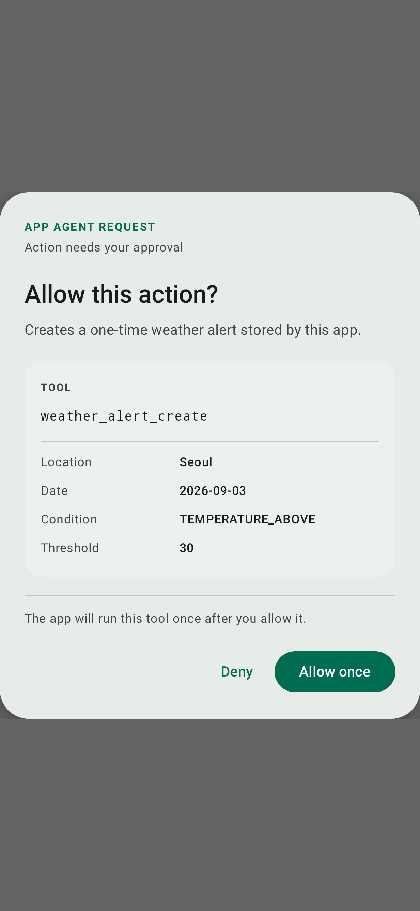

# `app-agent-ui-compose`

Optional Material 3 UI for application-owned tool approval. The module does not add fields to `ToolSpec` or change the wire protocol.



```kotlin
ToolApprovalDialog(
    request = request,
    onApprove = { resolve(request.call.id, approved = true) },
    onDeny = { resolve(request.call.id, approved = false) },
)
```

Dismissal invokes `onDeny`. Static labels and buttons are SDK-owned string resources. Dynamic content comes only from the registered `ToolSpec.description` and the actual `ToolCall.name` and `ToolCall.input`. Model-authored explanatory prose is not accepted by this UI.

Regenerate the checked-in preview with Roborazzi:

```bash
./gradlew :app-agent-ui-compose:recordRoborazziDebug
```
